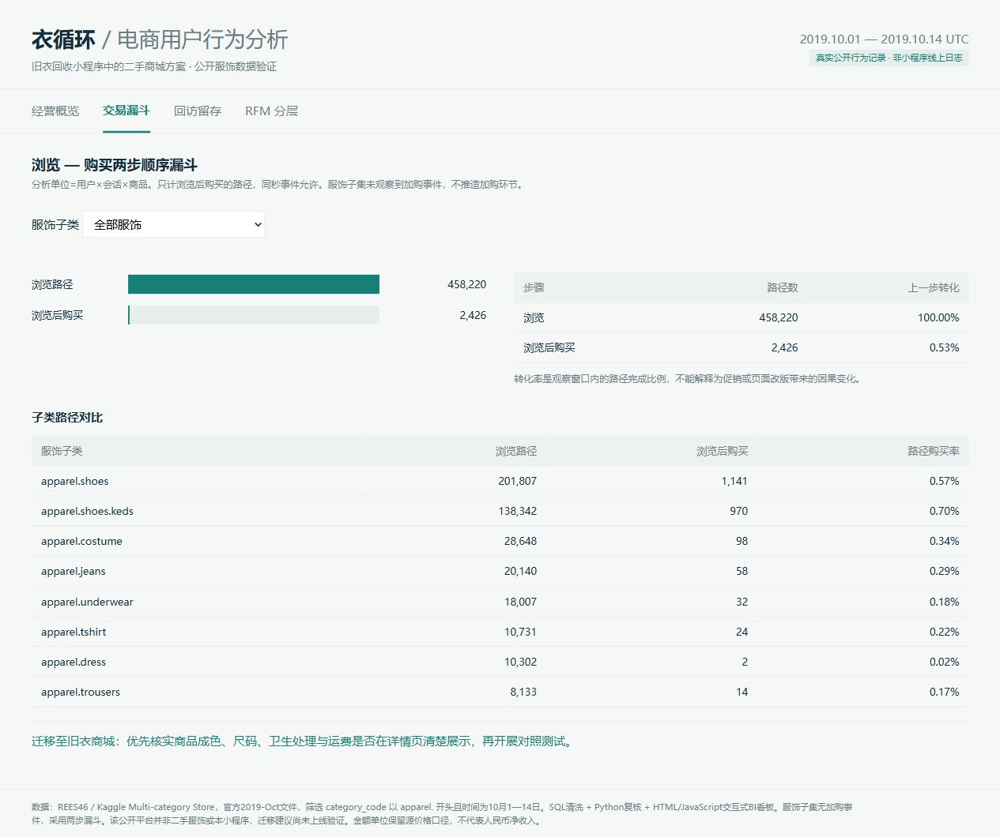

# 看板与分析截图

下载后打开[index.html](index.html)可离线查看四个页面：经营概览、交易漏斗、回访留存、RFM分层。交易漏斗支持服饰子类筛选。打开[SQL结果报告](sql-results.html)查看已执行SQL及实际返回值。

| 经营概览 | 漏斗 |
|---|---|
|  |  |
| 留存 | RFM |
|  |  |

本次实际工具是HTML/JavaScript。GitHub的HTML源码页不会运行看板，请下载打开。Power BI迁移目录提供CSV导入建议、DAX和主题，未在Power BI Desktop运行，不能作为原生Power BI截图使用。
