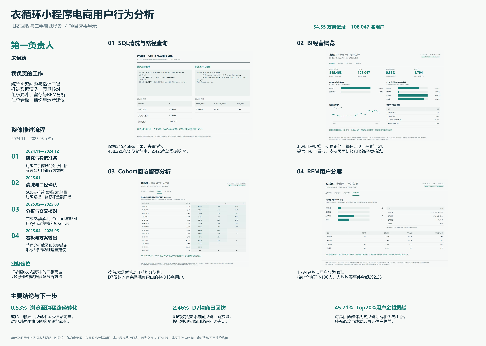
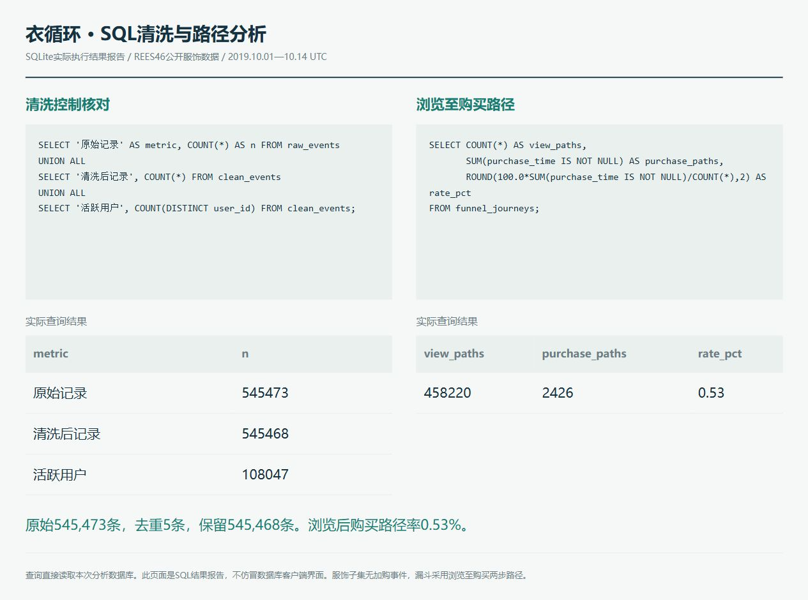
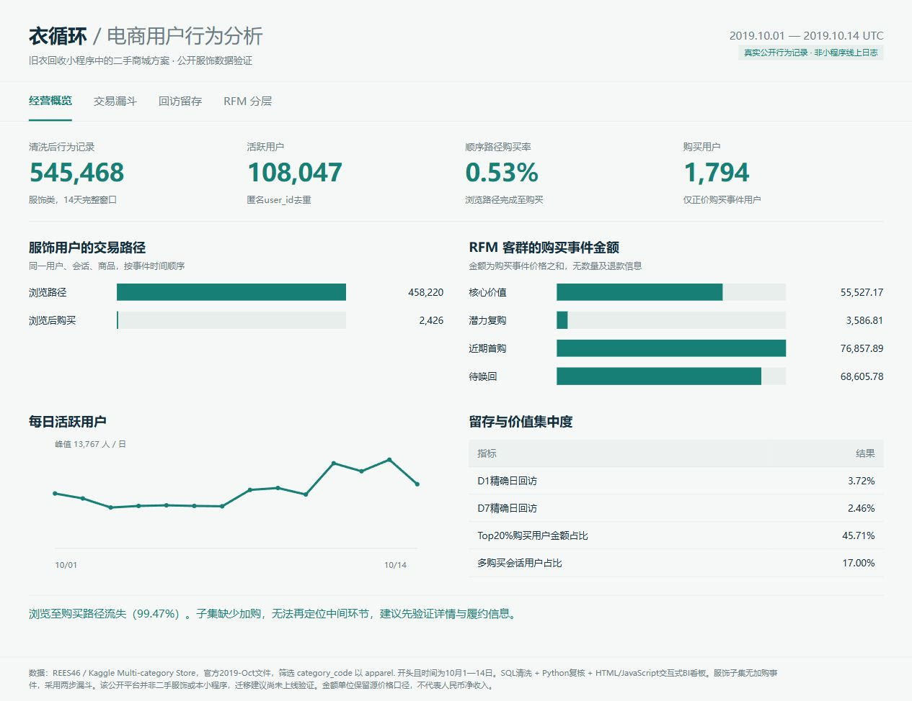
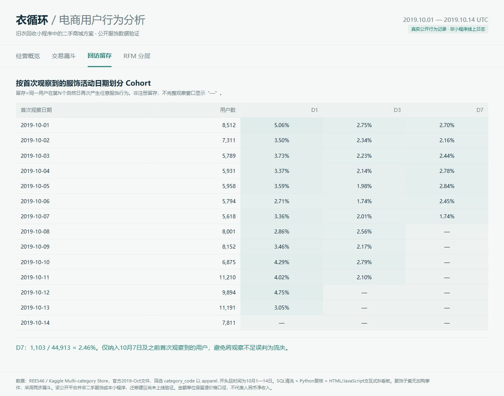
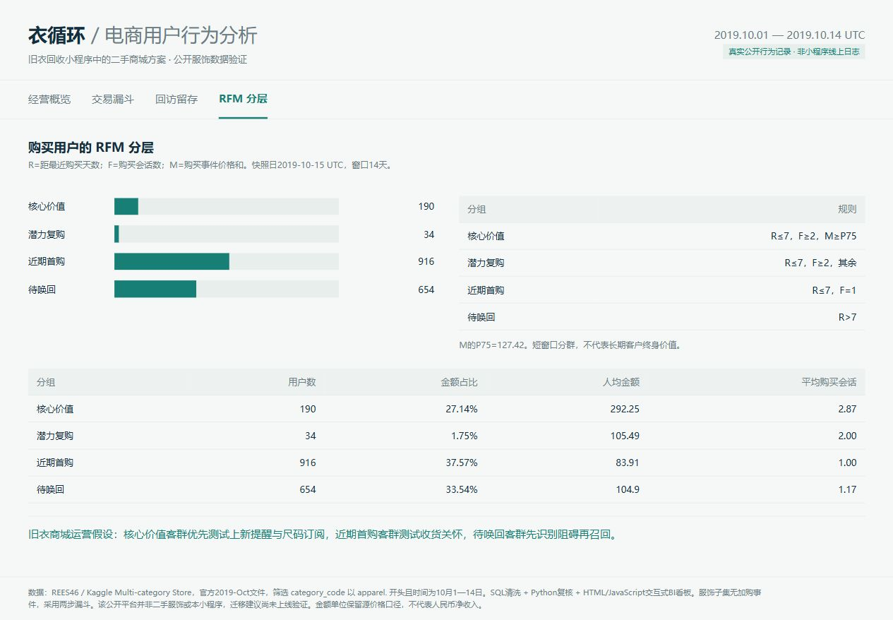

# 衣循环小程序电商用户行为分析

围绕旧衣回收小程序中的二手商城业务，展示数据清洗、交易漏斗、回访留存、RFM分层和运营建议。

**第一负责人：朱怡筠 · 项目周期：2024.11—2025.05（约）**

[下载可编辑PPTX](05-deliverables/project-overview.pptx) · [查看高清总览](05-deliverables/project-overview.png) · [阅读结论与建议](05-deliverables/conclusions.md) · [简历表述](05-deliverables/resume-summary.md)

## 先看这三个结果

| 分析问题 | 观察结果 | 用于旧衣商城的建议 |
|---|---|---|
| 浏览后的购买路径如何 | 458,220条浏览路径，2,426条浏览后购买，路径转化率0.53% | 前置成色、瑕疵、尺码与运费信息，再做对照测试 |
| 用户是否回来 | 完整观察窗内D7回访为1,103 / 44,913，即2.46% | 测试收货关怀与同尺码上新提醒 |
| 金额贡献是否集中 | Top20%购买用户贡献45.71%的购买事件金额 | 对高价值群体测试尺码订阅和优先上新 |

## 按过程浏览

| 文件夹 | 分类 | 内容 |
|---|---|---|
| [01-project](01-project/) | 项目与职责 | 负责人、项目定位、四阶段流程 |
| [02-data](02-data/) | 数据与口径 | 发布方、筛选规则、汇总CSV、来源记录 |
| [03-analysis](03-analysis/) | SQL与Python | 实际查询、数据清洗、留存与RFM脚本、复算步骤 |
| [04-dashboard](04-dashboard/) | 看板与截图 | 离线交互看板、SQL结果报告、5张截图、Power BI迁移材料 |
| [05-deliverables](05-deliverables/) | 成果与简历 | 单页巨幅PPTX、高清图、结论及简历条目 |

## 分析截图

| SQL清洗与实际查询 | BI经营概览 |
|---|---|
|  |  |
| Cohort回访留存 | RFM用户分层 |
|  |  |

## 负责人工作与项目流程

按负责人说明及本次成果整理：朱怡筠作为第一负责人，统筹研究问题与指标口径，推进数据清洗和质量核对，组织漏斗、留存及RFM分析，汇总看板、结论与运营建议。

| 阶段 | 时间安排 | 工作 |
|---|---|---|
| 研究与数据准备 | 2024.11—2024.12 | 明确二手商城分析目标，筛选公开服饰行为数据 |
| 清洗与口径确认 | 2025.01 | SQL去重与总量核对，定义路径、留存和金额指标 |
| 分析与交叉核对 | 2025.02—2025.03 | 完成漏斗、Cohort和RFM分析，用Python核对分母与汇总 |
| 看板与方案输出 | 2025.04—2025.05 | 整理看板截图、结论及3条待验证建议 |

起止月份由负责人提供，阶段按工作内容归纳，不作为逐月工作日志。

## 数据与工具说明

真实源数据来自[REES46发布方](https://data.rees46.com/)及其[Kaggle数据说明](https://www.kaggle.com/datasets/mkechinov/ecommerce-behavior-data-from-multi-category-store)。本次筛选2019.10.01—10.14 UTC的服饰类（含鞋），原始545,473条，去重后545,468条，包含108,047名用户。

公开平台不是二手商城，也不是本小程序的经营后台。数据用于验证分析方法，运营建议尚未上线实验。原问卷与交易数据未混算。项目周期与源数据的观察日期分别标注。

实际工具为SQLite SQL、Python和HTML/JavaScript交互式BI看板。截图均为实际结果，非AI经营界面。Power BI目录是迁移材料，尚未在Power BI Desktop运行，不提供虚假的原生Power BI截图。

服饰子集没有加购事件，所以使用浏览至购买两步漏斗。RFM的F是购买会话数，M是购买事件价格之和；缺少真实订单ID、数量、退款和成本，不能当作净收入或LTV。完整定义见[数据口径](02-data/README.md)。

## 本地查看与复算

下载仓库后，双击 `04-dashboard/index.html` 查看交互看板，或打开 `04-dashboard/sql-results.html` 查看SQL结果报告。GitHub文件预览不会执行HTML脚本。

需要复算时，按[分析说明](03-analysis/README.md)运行获取、分析和看板生成脚本。原始大文件和中间数据库不上传仓库，仅保留公开数据的汇总结果与来源记录。
